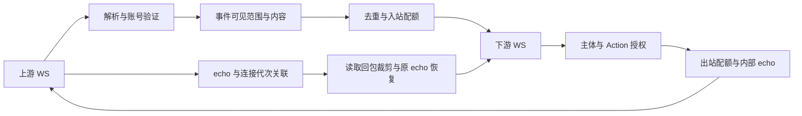

# 第一批架构

Node.js 24 直接执行 TypeScript，运行时仅依赖 `ws` 和 `yaml`。端点、账号、主体、路由、策略和会话是独立概念：一条 route 固定引用一个上游、一个下游和一份策略；身份不能靠业务报文切换。一个上游可被多条 route 共用，每个下游端点只绑定一条 route，每个端点最多一个活动连接。

| 模块 | 职责 |
|---|---|
| `config/` | 校验 YAML、填默认值、原子替换策略，监听配置目录 |
| `protocol/onebot11/` | JSON、Action、消息段、事件分类和失败回包 |
| `transport/` | 鉴权、WS 连接、TLS、ping/pong、退避重连、发送缓冲上限 |
| `identity/` | 固定凭据、账号绑定和每次连接的新 UUID 代次 |
| `policy/event/` | 先可见范围，后消息内容；纯函数 |
| `policy/action/` | 名称、目标、参数、消息段授权及读取回包裁剪；纯函数 |
| `runtime/` | 有界去重、分钟限流、echo 表及超时 |
| `route/` | 双向流水线、账号验证、回包隔离、会话与路由清理 |
| `observability/` | 一行一条结构化日志、计数、回环只读 HTTP |
| `extensions/coordination/` | 发言申请和释放接口；没有实现，也不接入核心流水线 |
| `index.ts` | 装配、启动、策略重载入口和退出清理 |

回包在事件过滤之前分流，且只发给发起调用的 route。每个请求保存 echo 的原值、JSON 类型、存在状态和上下游连接代次。回包消费一次后即删除映射；断线、超时、路由关闭也删除。内部 UUID 不复用，迟到回包没有广播或兜底匹配路径。

网关不建立应用发送队列。授权、配额检查和 `ws.send` 在同一同步执行段完成；重载后接收的请求使用新策略，已经写给上游的请求无法撤回。尚未返回的 `get_group_list` 结果使用最新可见范围裁剪。

全部暂态状态在进程内。去重键包含 route、接收账号、上游连接代次、群/私聊范围和 message_id；文本相同不会去重。每条 route 独立应用去重窗口。入站限额按 route/账号/群或用户计数；出站 route、principal、account、target 维度共享累计计数，策略不同的 route 仍各自按本次请求的限额检查。多个维度的额度同时检查，拒绝时不部分扣减。热重载保留现有计数，关闭的限流维度不累计。

第一批只接 Universal WS。没有独立 API/Event 通道、主动调度、持久化、补发、多副本协调、WebUI、SDK、兼容矩阵或完整示例库。
